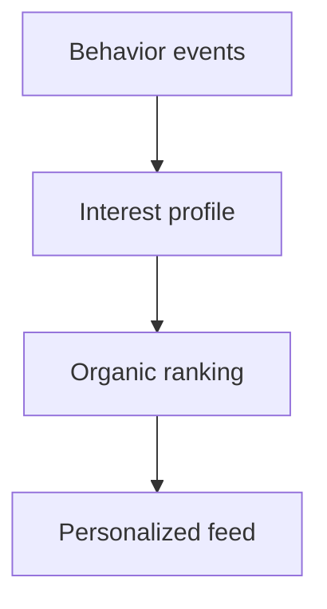
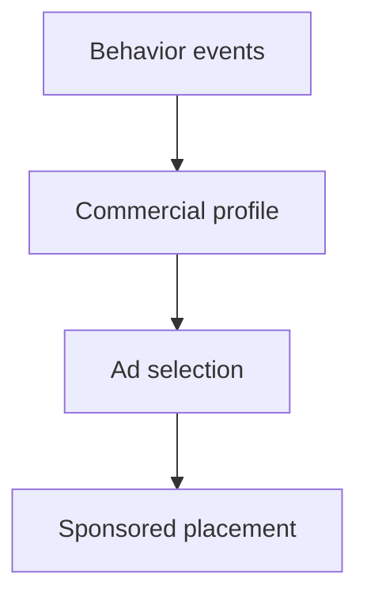

# Feed X-Ray architecture

Feed X-Ray is a single-page client simulation. `FeedXrayApp` owns session state. Ranking, ads, and tracking run in pure TypeScript modules and are not network services.

## Organic pipeline

1. **Behavior events** — likes, saves, shares, comments, dwell, skips, Not Interested, and unique views are appended to an in-memory log (`lib/events.ts`).
2. **Interest profile** — `lib/profile-engine.ts` applies deterministic teaching weights per category. User View never shows raw scores.
3. **Organic ranking** — `lib/ranking-engine.ts` scores the local catalog of 20 posts (affinity, freshness, quality, popularity, exploration, engagement, diversity, negative feedback, seen-post penalty).
4. **Personalized feed** — ranking is applied only when Feed Personalization is on and a snapshot is refreshed. Turning personalization off restores catalog order.

## Advertising pipeline

Commercial affinity (`lib/ad-engine.ts`) is a **separate** profile. Views alone do not build an ad profile. Ad Personalization off still shows a fictional sponsored card; selection becomes contextual. Ads are never `rankFeed()` candidates. The slot is inserted after a fixed number of organic posts.

## Event pipeline

`handleLike`, `handleSave`, visibility callbacks, and other card actions call `createBehaviorEvent` and `recordEvent`. The same event updates:

- Organic profile
- Post memory used by ranking
- Commercial profile (when the event type has a commercial weight)
- Timeline steps for strong actions

There is one event source. There are two consumers (organic vs commercial).

## Visibility lifecycle

`VisibilityTracker` (`lib/visibility-tracker.ts`) holds a pause count:

- Pause before programmatic feed reorder, Learn-view hide, or guided scroll
- Settle after layout with `IntersectionObserver.takeRecords()` and seed currently visible posts **without** emitting `post_view`
- Genuine views still require a hold threshold; leaves shorter than a flicker window are ignored
- Card unmount `detach` never emits a skip

This prevents synthetic skips/views when the DOM reorders.

## Ranking snapshots and pending profiles

When ranking is applied, `createRankingSnapshot` clones profile scores at that moment (`lib/engineer-view.ts`). Later likes change the **live** profile. Engineer Mode can show:

- **Applied snapshot** — scores that produced the current order
- **Pending** — live profile has moved since the last refresh

User View ranking does not silently rerank on every like.

## Ad selection

`selectSponsoredAd` reads the commercial profile and the Ad Personalization toggle. Reasons are contextual, personalized, or insufficient signal. Why This Ad explains the **selection**, not organic rank.

## Engineer observability

Engineer Mode is the same simulation with a mechanism UI:

- Live Event Console
- Interest and commercial vectors
- Ranking inspector and candidate table (snapshot order)
- Ad candidate rows
- Raw event JSON for a selected event

Switching User ↔ Engineer ↔ Learn does not reset events, profiles, or snapshots. Feed and Engineer workspaces stay mounted while hidden so inspection tabs survive Learn.

## Guided-demo state machine

`lib/guided-demo.ts` is a reducer (`idle`, `confirm-start`, `running`, `done`, `confirm-restart`). Auto-advance fires only when a live snapshot satisfies the step (real Technology like/save, personalization + ranking, Why This Post/Ad, Not Interested, Engineer Mode). The guide never clicks for the visitor and never invents scores.

## Learn view

`buildLearnSession` maps **current** counts, leader, personalization flags, and ranking movement into educational copy. Unique views alone do not fabricate an “active session.” Candidate retrieval is labeled as a real-world concept; this app ranks all 20 local posts.
